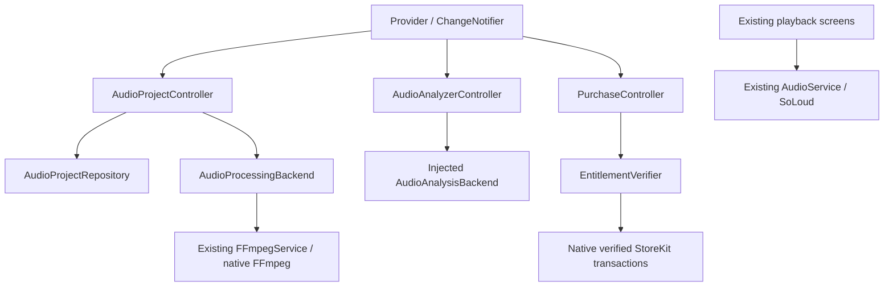

# Phase 2B — Smart Audio Studio technical foundation

Completed 12 November 2026 (Asia/Dhaka). Builds and test evidence are recorded under `docs/phase2b_logs/`.

This phase adds the technical foundation. The existing Boost, Equalizer, Voice and Export destinations remain in place. No Audio Studio screen, analyzer screen, waveform UI, navigation redesign, or AI claim is introduced.

## Architecture



Provider supplies one repository, one project controller and one processing backend. The analyzer controller subscribes to project identity/revision changes and invalidates old results. Existing screens continue using the compatible playback singleton and service methods. The shared purchase controller is the sole purchase-stream subscriber; screen subscriptions are now ChangeNotifier listeners rather than independent transaction handlers.

### Models and units

- `AudioProject` contains its ID, original/managed paths, display filename, duration, sample rate, channel count, codec, non-destructive trim interval, revision, creation/update timestamps, source byte count/fingerprint and an immutable processing configuration. Metadata is exposed both as a grouped object and through project getters.
- `ProcessingConfig` stores gain/bass/EQ in dB, bass frequency in Hz, ten independent bands at the existing frequencies, bounded voice controls and intensity, noise reduction, normalization target, limiter ceiling, and existing export formats/qualities. Collections are defensively copied. Invalid, nonfinite and out-of-range values are rejected, including a normalization ceiling outside FFmpeg's supported range.
- `AudioAnalysis` stores actual producer-supplied sample-range/channel measurements: sample rate, frame count, RMS/peak amplitudes, clipping threshold/counts, waveform extrema and spectrum frequency/power arrays. It validates dimensions and numeric relationships. Silence is stored as linear zero and exposed as negative-infinity dBFS, so JSON never invents or encodes a nonfinite meter value.
- `ExportRecord` stores successful output identity/path, measured metadata/bytes, job ID, exact source revision/configuration and creation time. It does not represent cancelled jobs as exports.

Project, configuration, analysis and export JSON documents use schema version 1 and reject unsupported versions instead of silently interpreting them. Durations serialize as integer microseconds; timestamps serialize in UTC. Processing enum definitions now live with the model and are re-exported by FFmpegService, preserving old screen imports and enum names.

### Repository and persistence

New projects live in application documents under `SmartAudioStudio/projects/<id>/`. Import copies the selected file into managed storage using bounded stream reads and awaited writes, probes the copied file through native FFprobe, and commits metadata only after success. The external original is never overwritten or moved. Failed imports remove their own incomplete managed directory.

JSON is flushed to a uniquely named temporary file and replaced through a same-directory rename on iOS/Android. The previous manifest is not deleted before the replacement succeeds. The Provider-owned repository serializes operations and enforces expected project revisions to reject stale saves. It is a single-writer application repository, not a cross-process database or an OS-wide locking service.

Managed paths are persisted relative to their project/storage root, so a relocated iOS application sandbox can load them. IDs and persisted relative paths are validated to prevent traversal. Original paths remain breadcrumbs for explicit recovery.

Missing or truncated managed files are reported as recoverable when the original remains available. Recovery can also take an explicitly selected replacement. It checks the byte count and streaming FNV-1a fingerprint before replacing the managed file, reprobes it and increments the revision. The fingerprint detects accidental source mismatch; it is not a cryptographic security signature. Missing exports remain in history with an availability check rather than being silently deleted.

Export history is a separate atomically replaced `exports.json`; output files live under `SmartAudioStudio/exports/`. Only outputs under managed export storage with matching nonzero file sizes can be recorded. Duplicate job/export records are rejected. Original documents and the old `VolumeBooster_Exports` directory are untouched.

### Processing jobs and FFmpeg adaptation

`AudioProcessingBackend.start` receives an immutable project/revision/configuration snapshot and a separate output path. It returns a job with a unique ID, monotonic scoped progress, cancellation and a single typed terminal result. States are queued, running, succeeded, failed and cancelled. A paused progress listener cannot block result completion. Cancellation before startup does not launch native processing; cancellation during native session creation is attached as soon as the session exists.

`FFmpegAudioProcessingBackend` wraps the existing FFmpegService and rejects overlapping jobs on that shared backend with a typed `busy` result. The new project entry point:

1. Confirms the managed source still exists and matches basic imported metadata/size.
2. Builds a deterministic native DSP recipe from the configuration.
3. Uses argument-list FFmpeg APIs, explicit audio stream selection and a unique partial output.
4. Attaches cancellation to the exact native session ID.
5. Probes successful output and checks duration tolerance, sample rate, channels and nonzero bytes before publication.
6. Renames the partial output into its final path and lets the controller commit history.

The controller validates that a backend returned the allocated path. Cleanup can remove only its own allocated export, even if an adapter erroneously returns an original/source path. An uncommitted output is cleaned up on failure or cancellation; a committed export/history record is preserved.

The new filter builder includes real ten-band EQ, bass, conventional voice DSP, optional single-pass loudness normalization and explicit limiter makeup behavior. It uses the correct denoise reduction parameter and omits EQ centers above source Nyquist. Single-pass normalization is not described as two-pass mastering, and a digital limiter is not a hearing-safety guarantee. Native output/audio-quality verification on physical devices remains a later integration gate.

Legacy processing methods and audio/video export choices remain available. Their algorithms are not rewritten in this phase. Legacy execution now receives per-session callbacks and tracks its own session IDs, so its cancel action does not globally cancel new project jobs. The earlier audited legacy denoise/gain/EQ limitations are not represented as fixed in the old screens merely because the new project recipe exists.

### Playback ownership and cleanup

AudioService retains its singleton and legacy method signatures. It now serializes source/transport operations, deduplicates engine initialization, tracks playback state/error/project metadata, subscribes to natural completion, prevents repeated play calls from creating duplicate voices, and provides true pause/resume and bounded seek.

New project consumers can call `loadProject` with an owner ID and receive a generation-scoped playback lease. Lease-gated play/pause/seek/release operations reject stale owners. Existing screens retain their shared compatibility API. Project processing configuration is a snapshot for offline rendering; loading a project does not claim to apply its complete ten-band/voice recipe to SoLoud's legacy live filters.

Shutdown awaits initialization/queued work, cancels source subscriptions and releases handles/sources before engine deinitialization. Async cleanup cannot notify a disposed ChangeNotifier. Provider uses `.value` for the process-wide playback and purchase owners; transient screens must not dispose those singletons. Call and await `shutdown` when deliberately releasing the audio engine.

### Analysis foundation

`AudioAnalyzerController` accepts an `AudioAnalysisBackend` interface, scopes progress and results to the requested project/revision, rejects mismatched source dimensions and invalidates/cancels stale requests. It is explicitly `unavailable` when no measurement backend is installed. The root graph intentionally does not install a fake decoder or fabricate diagnostics. The real decoder/measurement engine and analyzer UI belong to a later phase.

## Purchases and migration

The existing weekly, monthly and yearly IDs remain unchanged:

- `v.booster.weekly`
- `v.booster.monthly`
- `v.booster.yearly`

All four former purchase-stream listeners were replaced with listeners on `PurchaseController.shared`. Product lookup, buy, restore, verification and completion run through this owner. Duplicate transaction completion is prevented. Only a successfully verified snapshot matching the transaction can authorize completion; an unverified callback cannot turn a local flag into paid access.

As requested, iOS uses a small MethodChannel in AppDelegate to inspect StoreKit's cryptographically verified current entitlements, excluding revoked/upgraded transactions and unknown products. Active subscriptions use the verified expiry. For valid billing grace periods, it checks the verified renewal status and grace expiry instead of assuming an arbitrary extension. Apple documents current entitlements as including subscribed and in-grace-period states: [currentEntitlements](https://developer.apple.com/documentation/storekit/transaction/currententitlements) and [gracePeriodExpirationDate](https://developer.apple.com/documentation/storekit/product/subscriptioninfo/renewalinfo/graceperiodexpirationdate).

No new Swift package or Dart dependency is required. Runner support remains iOS 15.6. Native sandbox/device purchase behavior still needs StoreKit integration testing; compilation and mocked bridge contract tests are not evidence of a completed real transaction.

The old `is_premium_user` key is retained as migration evidence and is never sufficient to grant a subscription. Existing valid iOS customers can recover access from the native store entitlement, including after relaunch. Verification refreshes on foregrounding, purchase events and expiry. A transient verification failure does not erase an already verified, unexpired in-memory entitlement; it cannot manufacture new access. Rewarded temporary access retains its existing stored expiry and notifies listeners when it expires.

**Android configuration boundary, per your selected option:** the trusted verifier is intentionally left configurable. Local Android premium flags remain stored but no longer unlock paid subscriptions. Buy/restore is unavailable until a trusted Android/server verifier is installed; a purchase is not started while verification is unconfigured. Audio controls and rewarded temporary access remain available according to the existing gates. No Google credentials, app public key or server endpoint was invented.

An Android adapter implements `EntitlementVerifier`, verifies actual store/server evidence and returns current known-product entitlements with verified transaction IDs and expiry/revocation handling. Install it after Flutter binding initialization and before purchase-owner startup:

```dart
if (Platform.isAndroid) {
  PurchaseController.configureVerifier(yourTrustedAndroidVerifier);
}
```

The configuration hook rejects replacement after the owner starts, preventing a second live purchase subscriber. Do not implement it by reading the old boolean or accepting a callback status as proof.

The settings subscription action now opens the platform store's subscription-management page; it no longer clears a local flag and falsely reports billing cancellation. The unused simulated purchase path no longer grants premium. These are targeted purchase-flow corrections; screen structure is unchanged.

## New files

Runtime foundation:

- `lib/features/models/audio_model_json.dart`
- `lib/features/models/audio_project.dart`
- `lib/features/models/processing_config.dart`
- `lib/features/models/audio_analysis.dart`
- `lib/features/models/export_record.dart`
- `lib/core/service/audio_project_repository.dart`
- `lib/core/service/audio_processing_backend.dart`
- `lib/core/service/processing_job.dart`
- `lib/core/service/processing_filter_builder.dart`
- `lib/core/service/playback_ownership.dart`
- `lib/features/UI/controller/audio_project_controller.dart`
- `lib/features/UI/controller/audio_analyzer_controller.dart`
- `lib/features/UI/controller/purchase_controller.dart`

Tests:

- `test/audio/fixtures.dart` — generated real PCM WAV fixtures and a tiny test metadata decoder.
- `test/audio/models_test.dart`
- `test/audio/repository_test.dart`
- `test/audio/jobs_and_controllers_test.dart`
- `test/audio/purchase_controller_test.dart`

## Existing files modified in Phase 2B

- `lib/main.dart` — Provider graph; no routing/layout replacement.
- `lib/core/service/audio_service.dart` — compatible ownership/state/transport/cleanup foundation.
- `lib/core/service/ffmpeg_service.dart` — new project entry point/probe and scoped legacy execution; old API preserved.
- `lib/core/service/shared_preferance/Shared_Preferences.dart` — legacy entitlement compatibility routes through the verified owner; temporary-reward synchronization.
- `lib/features/UI/controller/premium_manager.dart` — compatibility facade cannot grant subscriptions from a boolean.
- `lib/features/UI/screen/splash_screen.dart`
- `lib/features/UI/screen/home_screen.dart`
- `lib/features/UI/screen/PurchaseScreen.dart`
- `lib/features/UI/screen/setting_screen.dart`
- `ios/Runner/AppDelegate.swift` — native verified entitlement bridge.

The four screen edits remove competing transaction handlers and add safe state-listener integration/mounted checks; their existing audio destinations and layouts remain. No Boost, EQ, Voice or Export screen layout file is modified.

The Phase 2A Podfile/lock checksum, Android ProGuard rule and corrected starter widget test remain in the workspace from that phase. They are not new Phase 2B changes. Pre-existing `.DS_Store` changes are untouched. There is no dependency version upgrade, new package, package ID change or deployment-minimum change. Legacy user audio/export files are not migrated or deleted automatically.

## Validation and remaining boundaries

All five final commands ran sequentially on the completed source. The raw command list/exit codes are in `phase2b_logs/validation_commands.json`, with additional assertions in `phase2b_logs/validation_summary.json`. Standard analysis is not suppressed.

| Command | Exit | Observed result |
| --- | --- | --- |
| `flutter pub get` | 0 | Existing dependency resolution preserved; pubspec.lock is byte-identical. |
| `flutter analyze` | 1 | 0 errors, 20 warnings, 144 informational findings. No new diagnostic types/locations compared with Phase 2A; remaining findings are existing issues. |
| `flutter test` | 0 | All 37 tests passed. |
| `flutter build ios --release --no-codesign` | 0 | `build/ios/iphoneos/Runner.app`, reported size 66.7 MB. |
| `flutter build apk --release` | 0 | `build/app/outputs/flutter-apk/app-release.apk`, reported size 239.0 MB. |

The built iOS application confirms bundle ID `m.volume.booster`, minimum OS 15.6, version 1.1.5/build 17. Android APK badging confirms package ID `m.volume.booster`, minimum SDK 24, target SDK 36, version 1.1.5/build 17 and arm64-v8a/armeabi-v7a/x86_64 libraries. iOS signing is disabled by the requested command, and the existing Android signing configuration is unchanged.

The existing future-compatibility warnings for Kotlin/Gradle/plugin integration and Swift Package Manager remain. Unrelated generated Xcode-project serialization changes were inspected and reverted after validation; the new AppDelegate verification code is retained. No generated plugin registrant was manually patched.

Raw `.log` files are present locally but excluded by the repository's existing ignore rules. The report and JSON summaries provide the retained evidence inventory; no commit was created.

The test suite covers JSON round trips and invalid values; immutable configuration; real-file import/copy/reopen and sandbox relocation; atomic-save revision conflicts; missing/truncated/replacement recovery; failed import cleanup; unsafe JSON paths; export history/missing outputs; job progress/cancellation/error/retry; stale ownership; controller export/disposal; unexpected backend paths; stale analysis invalidation; and entitlement/expiry/revocation/acknowledgment rules. Native FFmpeg/SoLoud execution and genuine store transactions are not replaced by those injected backend/gateway tests.

No physical-device import/export, real-time DSP quality, native interruption, StoreKit purchase, Google subscription verification or App Store submission is claimed complete. Existing live EQ/limiter limitations remain documented in the original audit. The next product phase can use this foundation without presenting those missing capabilities as implemented screens.
